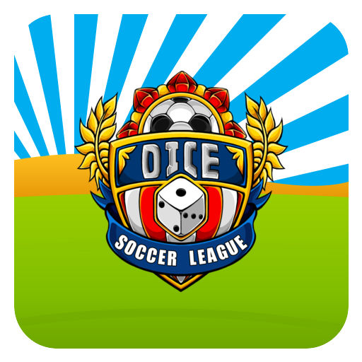
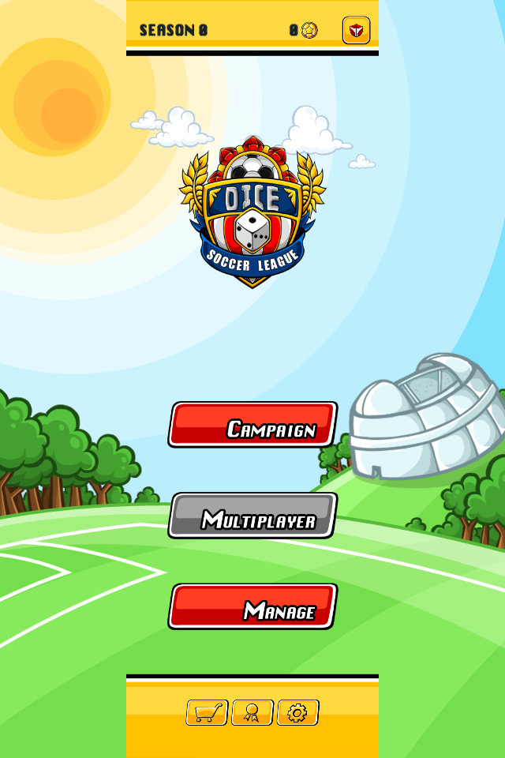
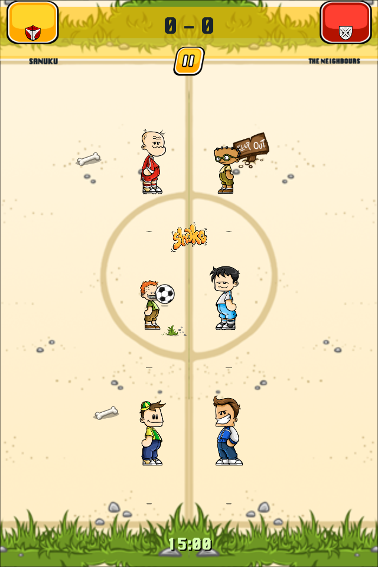
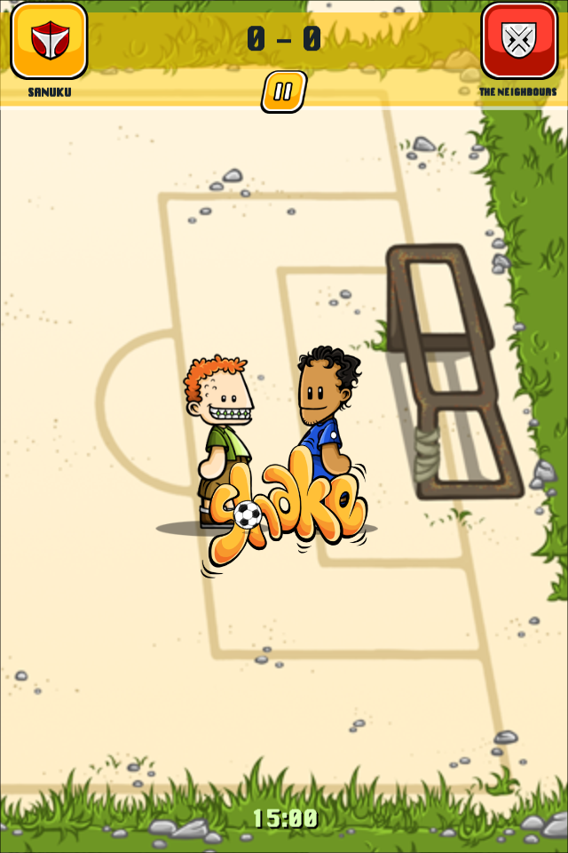
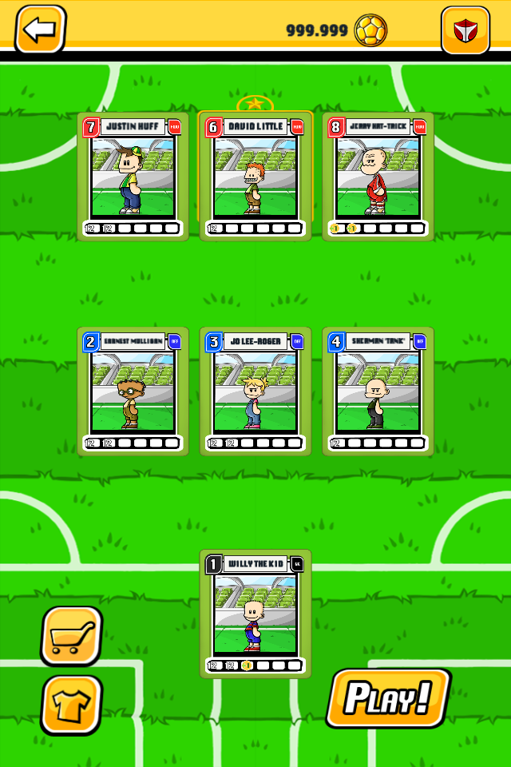
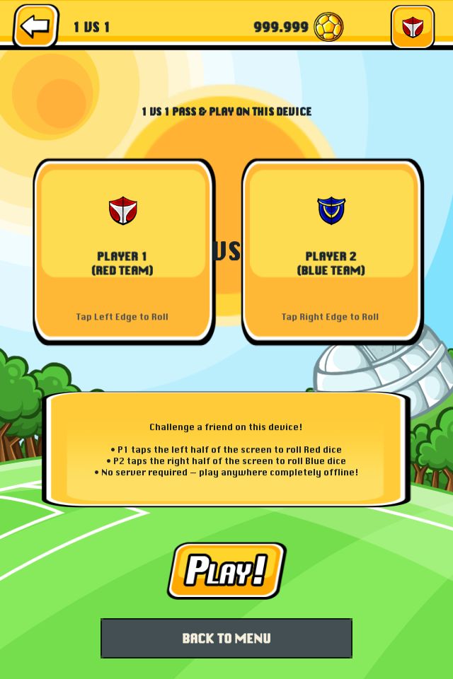
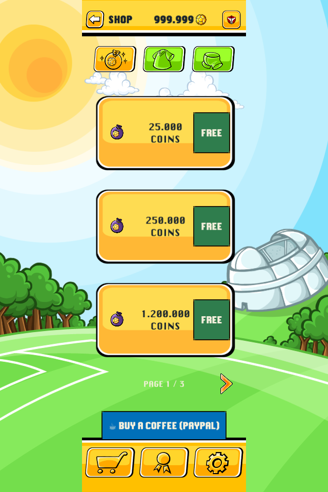

# Dice Soccer — Android Fan Remaster (2012 iOS Classic)

<p align="center">
  
</p>

<p align="center">
  <a href="https://github.com/FreeKaraZero/DiceSoccerLeagueOriginal/releases/latest"></a>
  
  
  
  
  
</p>

---

## 📖 Overview

**Dice Soccer** is an authentic, 1:1 fan remaster and historical preservation of the cult-classic 2011/2012 iOS title originally developed by **LambdaMu Games**. 

When Apple deprecated 32-bit application support in iOS 11, the original game vanished into abandonware. This project restores every single aspect of the classic experience — extracting 100% of the original Cocos2d sprite sheets, original audio effects, Krungthep typography, and character rosters — re-engineered from the ground up in **Unity 6 (6000.6 LTS)** as a native 64-bit Android application.

> [!IMPORTANT]
> **100% Non-Profit Fan Remaster**: All 96 historical players, jerseys, tournament cups, and coin packages are unlocked completely free. Zero ads, zero tracking, zero paywalls.

---

## 🗂️ Repository Branches Structure

This repository is organized into two primary branches:

| Branch | Description |
|:---|:---|
| **[`unity`](https://github.com/FreeKaraZero/DiceSoccerLeagueOriginal/tree/unity)** | **The Modern Remaster**: The complete, standalone Unity 6 project containing the full C# simulation engine, extracted assets, high-res adaptive icons, automated mobile build pipeline, and verification suites. |
| **[`original-ipa`](https://github.com/FreeKaraZero/DiceSoccerLeagueOriginal/tree/original-ipa)** | **Historical Archive**: The raw, decrypted 2012 iOS `.ipa` bundle (`Payload/Dice Soccer.app` and `iTunesArtwork`), preserved strictly for reverse engineering and digital archiving purposes. |

---

## 🎮 Key Features & Remaster Highlights

* **1:1 Authentic Match Simulation**:
  * 5 discrete tactical field zones (`-2` to `+2`) with authentic ball possession transfer.
  * Faithful 1-3-3 team formation (Goalkeeper on net, 3 outfielders per duel).
  * 3v3 outfield dice rolls with authentic player dice faces (values 1–32).
  * Intense 1v1 Central Forward vs Goalkeeper penalty duels when reaching the net zone.
  * 15-minute decrementing game clock with stoppage time.
* **All 96 Historical Players Unlocked**:
  * Every character from Novice, Amateur, Pro, Champion, and Legend leagues.
  * Real special abilities: *Tackle, Slide, Save, Header, Bicycle Kick, Charge, Dribble*.
* **100% Original Graphics & Audio**:
  * Original pixel-art character spritesheets (`PlayerFigureSS`, `Prompt1`, `ShopSS`).
  * Authentic stadium audio, crowd chants (`CrowdMix`), referee whistles, and chiptune theme music.
  * Original typography (`Krungthep.ttf`) preserved pixel-for-pixel.
* **✨ Brand-New Feature — Local 1v1 "Pass & Play" Multiplayer**:
  * Challenge a friend directly on the same device!
  * Take turns rolling dice, managing bench tactics, and battling for supremacy.
* **Modern Android & Pixel 10 Support**:
  * Native 64-bit ARM64 IL2CPP architecture (Package: `com.karazero.dicesoccer`).
  * Full-screen portrait layout with automatic Notch / Safe Area padding for modern aspect ratios (16:9, 18:9, 19.5:9, 20:9).
  * **Android Adaptive Icons**: Hand-crafted 512×512 full-bleed pitch background + high-res official crest foreground, perfectly framed on Google Pixel (circle) and Samsung (squircle).

---

## 📸 Screenshots

<p align="center">
  
  
  
</p>

<p align="center">
  
  
  
</p>

---

## 📥 How to Install and Play (Android)

### Direct APK Download
1. Head to the **[Latest Release](https://github.com/FreeKaraZero/DiceSoccerLeagueOriginal/releases/latest)** section.
2. Download **`DiceSoccer.apk`** (~45 MB).
3. Open the downloaded file on your Android device and tap **Install** (allow installation from unknown sources if prompted).
4. Launch **Dice Soccer** and start rolling!

### Via ADB (Command Line)
If your phone is connected to your PC with USB Debugging enabled:
```bash
adb install -r DiceSoccer.apk
```

---

## 🛠️ Building from Source

### Prerequisites
* **Unity 6 (6000.0 LTS or newer)** (Recommended: `6000.6.6f1`).
* Unity Android Build Support module (OpenSDK, NDK r23b+, Android SDK platform tools).

### Build Steps
1. Clone the repository and switch to the `unity` branch:
   ```bash
   git clone https://github.com/FreeKaraZero/DiceSoccerLeagueOriginal.git -b unity
   cd DiceSoccerLeagueOriginal
   ```
2. Open the project folder in **Unity Hub**.
3. Open the main startup scene:
   `Assets/Scenes/Main.unity`
4. To build the APK directly:
   * Go to **Unity Menu**: `Dice Soccer` -> `Configure Android and iOS`
   * Select **File** -> **Build Settings** -> **Android** -> **Build**
   * *Or run headless build from terminal:*
     ```bash
     Unity -quit -batchmode -projectPath . -executeMethod DiceSoccer.Editor.ConfigureMobileBuild.BuildAndroid -logFile /tmp/unity_build.log
     ```
   The compiled APK will be created at `Builds/Android/DiceSoccer.apk`.

---

## ☕ Support the Project

This is an independent non-profit fan project made out of pure love for preserving classic mobile gaming history. 

If you are enjoying the remaster and would like to buy a coffee to support the developer:
👉 **[paypal.me/Freekara3](https://paypal.me/Freekara3)**

---

## ⚖️ Legal & Preservation Disclaimer

This is a non-profit fan-made remaster developed solely for educational, archival, and historical game preservation purposes under Fair Use principles.

* All original visual assets, character designs, game concepts, and audio tracks remain the intellectual property of their original creators and rights holders (**LambdaMu Games**).
* This project is completely free of charge, contains no advertisements, no in-app purchases, and does not generate revenue.
* If you are a copyright holder and have concerns, please contact the repository owner.

---

## 🔬 Technical Reverse-Engineering Appendix

<details>
<summary>Click to view low-level reverse-engineering notes from the 2012 iOS ARMv7 binary</summary>

### Asset Extraction Pipeline
The asset extractor (`Tools/extract_assets.py`) extracts binary property lists, converts Cocos2d sprite sheets into individual PNG frames, decodes Apple's proprietary CgBI byte order, and writes game catalogs, audio, fonts, and atlas frame coordinates into `Assets/Resources/Original/`. `data/UnityCatalog.json` contains a structured catalog of 133 players, 67 abilities, and 5 tournament seasons.

### Binary Disassembly Observations (via r2)
- **Dice Face Resolution**: `PlayerDice.showRollDiceAnimation` in the original ARMv7 Mach-O executable calls `arc4random`, computes modulo 6 using reciprocal multiplication, and indexes into `diceSideIDArray` to store `actualFinalValue`.
- **Match Clock Decrement**: Each turn deducts approximately 45–90 seconds of match clock time with extra time allocated depending on duel complexity.
- **Formation Rules**: 1 Goalkeeper (active only in goal zone), 3 outfielders per line (DEF, MID, FWD), and 1 Central Forward specifically assigned for penalty shots against the opposing goalkeeper.

</details>
